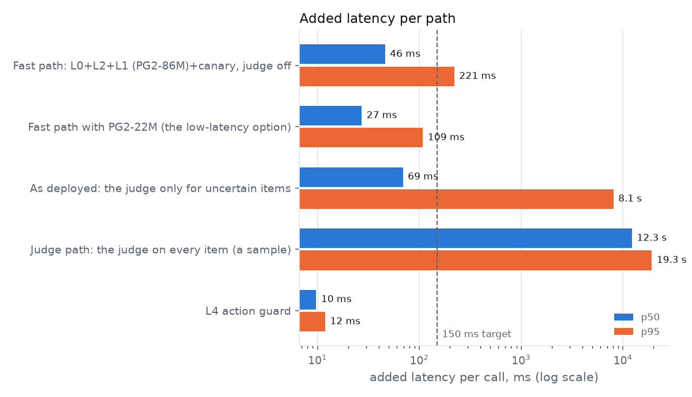

# PromptShield Benchmark: latency

Run: 20261116_1606, git 998fa4c, machine Intel64 Family 6 Model 140 Stepping 1, GenuineIntel, 8 threads, 15.7 GB RAM, CPU only, on mains power.
Judge qwen3:4b-instruct, L1 threshold 0.10, task alignment off (the default).
Items: deepset-test 116, lab 55.

Each number is the time one request takes through the real app in-process (no network):
pipeline, policy, redaction and the event write, which is what a tool call waits for in
gateway mode. Model loading is reported apart as the cold start. One warm-up request
per path is left out.

## Headline: added latency per tool result
Fast path p50 46 ms: meets the target of 150 ms (CONTEXT.md, CPU).

| Path | n | p50 | p95 | p99 | max |
| --- | --- | --- | --- | --- | --- |
| Fast path: L0+L2+L1 (PG2-86M)+canary, judge off | 513 | 46 ms | 221 ms | 457 ms | 1.1 s |
| Fast path with PG2-22M (the low-latency option) | 513 | 27 ms | 109 ms | 177 ms | 446 ms |
| As deployed: the judge only for uncertain items | 171 | 69 ms | 8.1 s | 18.1 s | 19.3 s |
|   of which judged | 9 | 9.7 s | 19.3 s | 19.3 s | 19.3 s |
|   of which not judged | 162 | 62 ms | 258 ms | 547 ms | 1.4 s |
| Judge path: the judge on every item (a sample) | 20 | 12.3 s | 19.3 s | 20.8 s | 20.8 s |
| L4 action guard (per tool call) | 200 | 10 ms | 12 ms | 14 ms | 19 ms |

## Fast path by layer (the pipeline's own timing)
| Layer | n | p50 | p95 | p99 | max |
| --- | --- | --- | --- | --- | --- |
| CANARY | 513 | 0 ms | 0 ms | 0 ms | 0 ms |
| L0 | 513 | 0 ms | 2 ms | 3 ms | 4 ms |
| L1 | 513 | 37 ms | 180 ms | 377 ms | 1.0 s |
| L2 | 513 | 0 ms | 1 ms | 1 ms | 2 ms |

## Fast path by item size
| Item size | n | p50 | p95 | p99 | max |
| --- | --- | --- | --- | --- | --- |
| < 500 chars | 456 | 43 ms | 110 ms | 147 ms | 236 ms |
| 500-2000 chars | 57 | 204 ms | 987 ms | 1.1 s | 1.1 s |

## L4 action guard, by call (50 rounds)
| Call | n | p50 | p95 | p99 | max |
| --- | --- | --- | --- | --- | --- |
| read_file | 50 | 9 ms | 12 ms | 13 ms | 13 ms |
| list_files | 50 | 9 ms | 11 ms | 19 ms | 19 ms |
| http_post to an unknown host | 50 | 10 ms | 13 ms | 15 ms | 15 ms |
| send_email to an outside address | 50 | 10 ms | 12 ms | 12 ms | 12 ms |

## Cold start (app startup including model loading)
- Fast path: L0+L2+L1 (PG2-86M)+canary, judge off: 5.1 s
- Fast path with PG2-22M (the low-latency option): 2.2 s
- As deployed: the judge only for uncertain items: 9.3 s
- Judge path: the judge on every item (a sample): 10.3 s

## Limitations
- One laptop CPU, no GPU; another machine gives other numbers.
- The judge path's time is almost all the local LLM; a GPU or a smaller judge changes it.
- Task alignment (an LLM check in L4) is off by default and wasn't measured here.
- In-process timing leaves out network hops between a remote client and the gateway.
